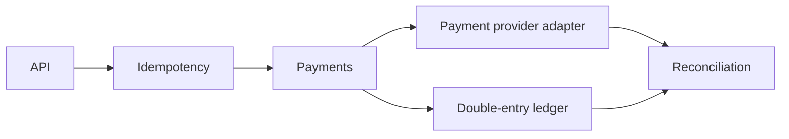

# payrail

Auditable payment orchestration and double-entry ledger primitives for teams that need correct money movement without adopting an entire payment platform.

The first release provides:

- Integer minor-unit money with ISO-style currency validation
- Idempotent payment creation
- Explicit authorization, capture, failure, and refund transitions
- Balanced, single-currency journal validation
- Duplicate-reference protection for replay-safe posting

Run `cargo test`. This project does not process real funds or store card data. Provider adapters, PostgreSQL persistence, webhook verification, reconciliation imports, an HTTP API, and an operations UI will be added behind the tested domain core.

## Non-goals

- Card-data storage or PCI scope
- Floating-point money
- Pretending provider success equals settled funds

