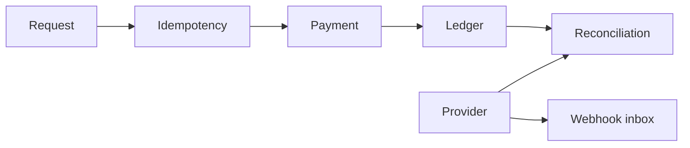

# payrail

Payment and ledger primitives in Rust.

The domain core handles integer minor-unit money, idempotent payment creation, authorization and capture transitions, balanced journal entries, replay-safe references, provider webhook deduplication, and settlement reconciliation.



```sh
cargo test
```

This repository does not process real funds, verify provider signatures, or store card data. It is a tested domain core, not a payment processor.
